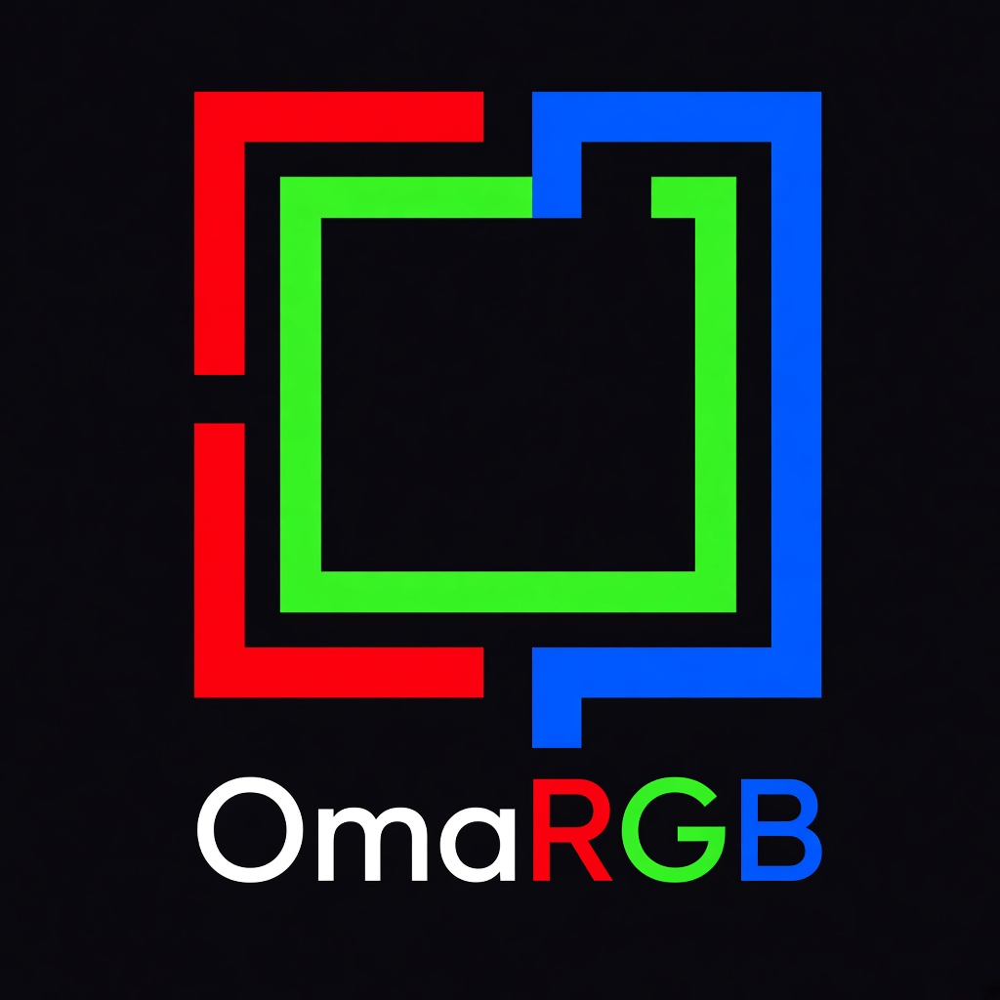
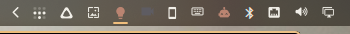
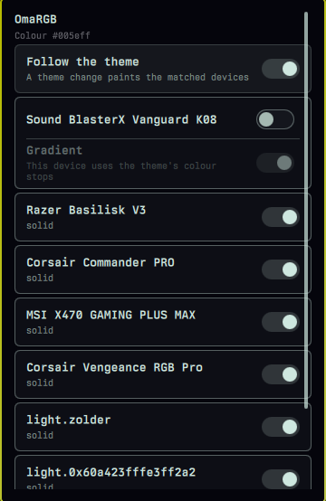

# OmaRGB

<p>
  
</p>

OmaRGB paints RGB hardware from the active Omarchy theme. Mice, DRAM, motherboard lighting, Corsair hubs, laptop keyboards, and the Sound BlasterX Vanguard K08 are selected from a database of USB, PCI, and board ids, then handed to a matching engine.

The site is [ekollof.github.io/OmaRGB](https://ekollof.github.io/OmaRGB/).

After install, Omarchy's RGB commands (`omarchy-theme-set-keyboard`, OpenRGB, ASUS `asusctl`, Framework `qmk_hid`) are shadowed and the theme-set hook runs OmaRGB instead.

## Install

```bash
~/Work/OmaRGB/install.sh
```

This links `omargb` onto `PATH`, installs a theme-set hook and a login hook, and watches `~/.local/state/omarchy/current/theme` so a wallpaper palette update still recolours the hardware. It installs a painter's packages only when this machine has a matching device. The package list is `share/painters.toml`. [wallpaperctl](https://github.com/ekollof/wallpaperctl) builds that palette from the current wallpaper and rewrites `colors.toml` without running `omarchy theme set`.

Running it again fast-forwards this checkout from its upstream when the worktree is clean, then refreshes the hooks, shims, and units. A dirty or diverged checkout is left untouched. The stepped-aside painters stay stepped aside. `omargb` and `share/devices.toml` are the files in this checkout, reached through the link.

The next graphical login puts `~/.local/share/omargb/shims` first on `PATH`, which makes the stock RGB commands do nothing. Until that login, Omarchy may paint first and the theme hook corrects it.

`uninstall.sh` removes the hooks, the watcher, and the shims, and puts back anything the installer stepped aside.

## Commands

```bash
omargb plan     # show the match and the colours, change nothing
omargb apply    # paint matched hardware
```

The bar icon opens the same controls: follow the theme or leave the lights as they are, per device, and a solid colour or the theme gradient on the Vanguard K08. The choice is `~/.config/omargb/behaviour.json`. `omargb plan --json` prints it with the matched devices.

<p>
  
</p>
<p>
  
</p>

In a terminal the report uses Omarchy's gum theme: an accent border and the green or red status mark. The theme hook and the palette watcher are not a terminal, so they log the plain lines.

Colours come from the active theme. Gradient devices use the theme's colour stops. One-colour devices use a single stop. Black, white, and the terminal chrome slots `color0`, `color7`, `color8`, and `color15` are left out.

## Adding hardware

New devices and engines start as a GitHub issue. The steps are in [CONTRIBUTE.md](CONTRIBUTE.md). The entry itself is one `[[device]]` block in `share/devices.toml`:

| Field | Meaning |
|---|---|
| `bus` | `usb`, `pci`, `dmi`, `openrgb`, or `hass` |
| `id` | `vendor:product` hex, `vendor:name` for a DMI board, product family, or product name, an OpenRGB device name, or a Home Assistant entity id (wildcards allowed) |
| `engine` | `vanguard_k08`, `openrgb`, `openlinkhub`, `asus_rog`, `framework16`, or `homeassistant` |
| `effect` | `solid` or `gradient` |
| `openrgb` | Name substring, when that engine has to find the device inside OpenRGB |
| `fallback` | Engine used when the first one cannot run |

USB and PCI ids come from `lsusb` and `lspci -nn`. A board that has no USB lighting id is matched on `board_vendor:board_name`, `sys_vendor:product_family`, or `sys_vendor:product_name` from `/sys/class/dmi/id`. The ASUS ROG and Framework Laptop 16 rows use the same DMI checks as Omarchy's `omarchy-hw-asus-rog` and `omarchy-hw-framework16`. DRAM that only OpenRGB can see uses `bus = "openrgb"`. Home Assistant lamps come from `~/.config/hass.cfg` (`[auth]` with `server`, `token`, and a comma-separated `lamp` list). The file must be readable only by its owner. A lamp is painted when that list names it and a `hass` row matches the entity id. Anything not listed is left alone.

Engines live in `omargb/engines/`. A new engine is a class with `name` and `apply(theme, targets, dry_run)`, registered in `omargb/engines/__init__.py`.

## Engines shipped here

- `vanguard_k08` speaks the K08 hidraw protocol and changes only LED colours, so the key map is left as the keyboard has it.
- `openrgb` sets static mode at full brightness to the theme colour.
- `openlinkhub` posts the theme colour to the local OpenLinkHub service (`127.0.0.1:27003`, `/api/color/all`). If that service is down, the Commander Pro entry falls back to OpenRGB.
- `asus_rog` and `framework16` cover the laptop keyboards Omarchy used to paint itself.
- `homeassistant` sets a theme colour on Home Assistant lights that are already on. The default is the warmest palette colour, so a blue stop does not win. The bar panel cycles warmest, least blue, most saturated, coolest, and brightest.

## Tests

```bash
python3 tests/test_omargb.py
```

Agents working in this tree should read [AGENTS.md](AGENTS.md) first.

OmaRGB is [MIT licensed](LICENSE).
